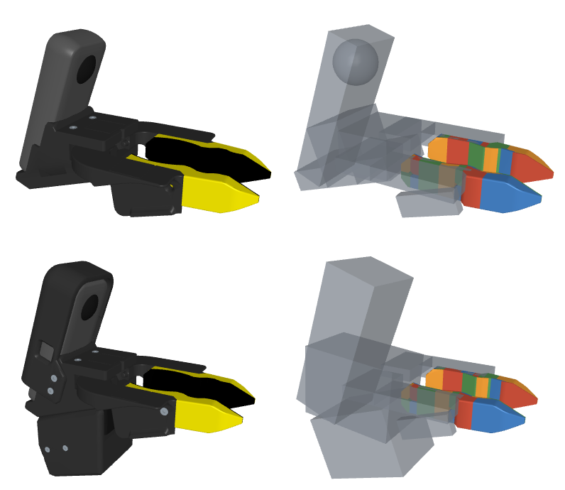

# Specialist Description

URDF, MJCF and xacro descriptions of the Specialist grippers. The scripts in `scripts/` make them from the Onshape CAD with [onshape-to-robot](https://github.com/Rhoban/onshape-to-robot).



Rows: `specialist_handheld`, `specialist_actuated`. Columns: visual meshes, colliders.

## Variants

Each variant has two finger joints on the `base` link, and a 1:1 gear couples them. The URDF states the gear as a `<mimic>` on `left_finger`, and the MJCF as an `<equality>`. Neither file has an actuator. A simulator adds its own actuator on `right_finger`, the joint that the servo of the actuated variant turns. The `camera` frame is on the Insta360 X3, and its +x axis is the optical axis.

| Variant | Purpose |
|---|---|
| `specialist_handheld` | A person holds it to record demonstrations. |
| `specialist_actuated` | A robot arm carries it. An STS3215 servo turns the fingers. |

## Use

```bash
uv add git+https://github.com/specialist-ai/specialist_description.git
```

```python
import mujoco
from specialist_description import get_mjcf_path

model = mujoco.MjModel.from_xml_path(str(get_mjcf_path("specialist_actuated")))
```

`get_urdf_path` and `get_xacro_path` give the other two formats. The URDF and the MJCF give mesh paths relative to the file, so load these files where they are. The xacro macro gives `package://` mesh paths, and its `mesh_root` parameter changes them.

The repository is also a ROS 2 `ament_cmake` package. The xacro macro adds a prefix to each name, so one robot can carry two grippers:

```xml
<xacro:include filename="$(find specialist_description)/robots/specialist_actuated/xacro/specialist_actuated.macro.xacro"/>
<xacro:specialist_actuated prefix="left_" parent="left_wrist">
  <origin xyz="0 0 0.02" rpy="0 0 0"/>
</xacro:specialist_actuated>
```

## Layout

```
specialist_description/robots/<variant>/
  urdf/    URDF
  mjcf/    MJCF, compiled from the URDF
  xacro/   xacro macro, made from the URDF
  meshes/  meshes
  cad/     inputs of the scripts
```

The scripts write all directories except `cad/`. Do not edit them. Change the inputs, and then generate the files again.

| Input | Content |
|---|---|
| `cad/config.json` | Onshape document and export options |
| `cad/colliders.json` | collider policy of each part |
| `cad/scad/<part>.scad` | collider primitives of a part, in millimeters |
| `cad/joint_properties.json` | friction and armature of the joints, and the gear |

## Colliders

`cad/colliders.json` maps part names to policies. Each key is a `re.fullmatch` pattern, and the first match wins. The last key is `".*"`, so that each part has a policy.

| Policy | Collider |
|---|---|
| `"mesh"` | the part mesh, cut into convex hulls `<part>_<index>` by [CoACD](https://github.com/SarahWeiii/CoACD) |
| `"scad"` | the boxes and spheres in `cad/scad/<part>.scad` |
| `"none"` | no collider |
| `{"mirror": "<part>"}` | the CoACD hulls of `<part>`, mirrored across the yz plane of the part frame |

MuJoCo collides a mesh as its convex hull, and a hull fills the profile of a fingertip. Thus CoACD cuts the tips into convex pieces.

Onshape triangulates the left and right tips differently, and CoACD cuts different meshes into different hulls. Thus CoACD cuts only the right tips, and the left tips use `mirror`.

Each geom in the MJCF has a unique name. A mesh geom has the name of its mesh, with an index if two geoms use the mesh. A primitive has the name `<body>_collider_<index>`. A primitive collides with the meshes but not with other primitives, because a primitive is larger than its part. The mesh colliders have `condim` 4, because only torsional friction stops a pinched object from turning.

## Generate

1. Install the dependencies:

   ```bash
   uv sync
   sudo apt install openscad
   ```

2. Paste `cad/config.json` into the [onshape-to-robot app](https://cad.onshape.com/appstore/apps/File%20Export/698b9abb84adb494ca5d5d5a) on the assembly tab.
3. Export the robot.
4. Extract the download into `cad/`, but keep the committed `config.json`.
5. Run the three scripts:

   ```bash
   uv run scripts/onshape_to_urdf.py specialist_handheld
   uv run scripts/urdf_to_mjcf.py specialist_handheld
   uv run scripts/urdf_to_xacro.py specialist_handheld
   ```

If you change only an armature in `cad/joint_properties.json`, run only `urdf_to_mjcf.py`.

To edit a scad collider, run `uv run scripts/edit_collider.py <variant> <part>`. OpenSCAD opens the file and shows the link of the part as a reference. The script needs the export in `cad/`.

To draw `docs/preview.png` again, run `uv run scripts/render_preview.py`. To run the tests, run `uv run pytest`.
